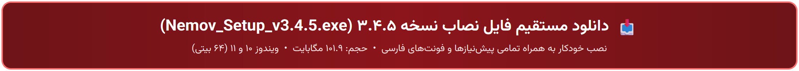
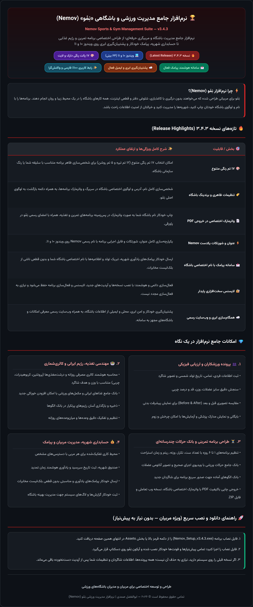

# 🏆 نرم‌افزار جامع مدیریت ورزشی نِمُو (Nemov)
### قدرتمندترین، مدرن‌ترین و پیشرفته‌ترین پلتفرم دسکتاپ مدیریت باشگاه و مربیگری حرفه‌ای
**طراح و توسعه‌دهنده: مهندس ابوالفضل صمدی کوچکسرائی**

 

[-blue.svg?style=for-the-badge&logo=windows)](https://github.com/AbolfazlSamadi2006/Nemov-App/releases/latest)

  

  

  

## 🌟 معرفی نرم‌افزار نِمُو (Nemov)

**نِمُو (Nemov)** یک راهکار نرم‌افزاری تمام‌عیار، کاملاً بومی و مهندسی‌شده برای باشگاه‌های ورزشی، مربیان بدنسازی و پرورش اندام، فیتنس و کلینیک‌های حرکات اصلاحی است. این نرم‌افزار با بهره‌گیری از آخرین استانداردهای طراحی نرم‌افزاری، پایگاه داده محلی سریع و امن SQLite و امکان همگام‌سازی ابری، تمامی نیازهای یک مجموعه ورزشی را از صفر تا صد پوشش می‌دهد.

---

## 🚀 مهم‌ترین قابلیت‌ها و امکانات کلیدی:

### ۱. 📐 رابط کاربری هوشمند، سایدبار کشویی و بهینه‌سازی چندرزولوشنی (جدید در نسخه ۳.۴.۵)
- **سایدبار باز و بسته‌شونده کشویی (`230px ↔ 74px`):** امکان جمع و باز کردن سایدبار با انیمیشن نرم به سمت راست (هم به‌صورت دستی از هدر سایدبار و هم به‌صورت خودکار در پنجره‌های زیر `1050px` با حفظ اولویت کنترل کاربر)، نمایش آیکن‌های وسط‌چین با راهنمای متنی فارسی (Tooltip) و نشانگر فشرده یادآوری‌های روز (`🔔`).
- **هماهنگی کامل با انواع نمایشگرها (`ui_scaling.py`):** مقیاس‌دهی خودکار پنجره‌ها و دیالوگ‌ها در لپ‌تاپ‌های کوچک (`۱۳۶۶×۷۶۸` با اسکیل `۱۵۰%`)، مانیتورهای استاندارد و صفحه‌نمایش‌های بزرگ `۲K / ۴K` و تلویزیون.
- **داشبورد و الگوهای غذایی بدون بریدگی متن:** حفظ حداقل عرض خوانای ستون ورزشکار، شکست هوشمند و وسط‌چین ۲ ردیفه دکمه‌های دسترسی سریع در عرض‌های باریک، نمایش فارسی خالص هدف‌های رژیم و گسترش ستون `پروتئین / کربوهیدرات / چربی` جهت نمایش کامل مقادیر `P / C / F`.

### ۲. 🎨 لوگوی دوگانه هوشمند برای PDF و تم‌های روشن (جدید در نسخه ۳.۴.۵)
- استفاده خودکار از نسخه ذغالی/سربی پرکنتراست لوگو در تمامی خروجی‌های PDF (تمرینی، تغذیه و مالی) و تم‌های روشن رابط کاربری جهت خوانایی کامل روی کاغذ سفید، همراه با حفظ نسخه سفید درخشان اصلی در تم‌های تیره و حفظ کامل لوگوی اختصاصی باشگاه‌ها.

### ۳. 📱 احراز هویت پیامکی فوق‌سریع و ورود دومرحله‌ای (نسخه ۳.۴.۴)
- انتقال کامل سامانه ارسال رمز یکبار مصرف (OTP) از ایمیل به سرویس پیامک ملی و الگوهای خدماتی (SMS.ir Pattern).
- ارسال کد تایید ۵ رقمی به صورت آنی و زیر ۳ ثانیه به تلفن همراه سازنده/مربی بدون تاخیر و بدون نیاز به اینترنت بین‌الملل.
- رابط کاربری بهینه‌شده و یکدست ورود جهت تجربه کاربری سریع و بدون خطا.

### ۴. 🔄 سیستم به‌روزرسانی هوشمند و درون‌برنامه‌ای
- اتصال پایدار به مخزن رسمی گیت‌هاب و بررسی لحظه‌ای آخرین نسخه‌ها.
- بررسی خودکار پس‌زمینه بدون افت سرعت یا فریز رابط کاربری (Background Multi-Threading).
- امکان دانلود نسخه جدید مستقیماً داخل نرم‌افزار با نوار پیشرفت زنده و اعمال خودکار به‌روزرسانی تنها با یک کلیک.
- تفکیک کامل بخش درباره برنامه به دو تب مدرن: **اطلاعات برنامه و به‌روزرسانی** و **اطلاعات توسعه‌دهنده**.

### ۵. 🏋️‍♂️ سیستم پیشرفته طراحی برنامه‌های تمرینی
- بانک کامل بیش از **۱۰۲۳ حرکت ورزشی** به تفکیک ۲۳ عضله آناتومیک.
- استریم آنلاین و مستقیم ویدیوی اجرای صحیح کلیه حرکات با کیفیت عالی از سرور اختصاصی.
- سیستم هوشمند فیلتر و جستجوی چندمعیاره و ترجمه فارسی دقیق موارد منع پزشکی.
- خروجی شکیل PDF استاندارد با لوگوی اختصاصی باشگاه و هایپرلینک به پلیر ویدیو.

### ۶. 🥗 سامانه تخصصی برنامه‌ریزی تغذیه و رژیم غذایی
- فرم هوشمند، فشرده و تاشوی آکاردئونی جهت افزایش فضای دید جدول برنامه غذایی.
- محاسبه آنی و بلادرنگ کالری و درشت‌مغذی‌ها (پروتئین، کربوهیدرات، چربی).
- دیتابیس غنی مواد غذایی با مقادیر استاندارد و امکان سفارشی‌سازی وعده‌ها.

### ۷. 👥 مدیریت جامع اعضا و پرونده سلامت
- ثبت مشخصات فردی، آنتروپومتری و تاریخچه پزشکی و ورزشی.
- بایگانی تصاویر روند تغییرات بدنی ورزشکاران (Progress Photos).
- ثبت خودکار وضعیت فعال/منقضی بر اساس سررسید عضویت.

### ۸. 📱 سامانه پیامک و اطلاع‌رسانی یکپارچه
- ارسال پیامک گروهی و تکی به ورزشکاران با پیش‌نمایش گرافیکی تلفن همراه.
- شمارشگر پویا و بلادرنگ دریافت‌کنندگان در بالای جدول.
- فیلترهای خودکار: اعضای فعال، منقضی، بدهکاران شهریه و تبریک تولد.

### ۹. 💰 حسابداری، صندوق و امور مالی
- ثبت دقیق تراکنش‌های مالی، شهریه اعضا و حقوق و پورسانت مربیان.
- تمدید خودکار عضویت شاگرد بلافاصله پس از ثبت شهریه.
- گزارش‌گیری‌های مالی تفکیک‌شده به همراه صدور صورت‌حساب رسمی.

### ۱۰. 🎨 موتور قالب و تم‌های اختصاصی (۱۷ پالت رنگی)
- ۱۲ تم دارک حرفه‌ای و چشم‌نواز (Crimson، Gold، Orange، Purple، Pink، Cyan، Bright Green، Silver، Bronze، Pure Black، Dark Green، White Blue).
- ۵ تم لایت با کنتراست بالا.
- سازگاری کامل با تمپلیت‌های بصری و رنگ‌بندی داینامیک.

### ۱۱. 💾 پشتیبان‌گیری چندلایه و سرور ابری اختصاصی
- پشتیبان‌گیری خودکار، تهیه فایل‌های ZIP رمزنگاری‌شده محلی.
- اتصال به سرور اختصاصی (`storage.nemovapp.ir`) برای بازیابی داده‌ها و امنیت ۱۰۰ درصدی در برابر خطرات سخت‌افزاری.

---

## 💻 راهنمای نصب و راه‌اندازی

1. فایل نصاب آخرین نسخه را از بخش **[Releases](https://github.com/AbolfazlSamadi2006/Nemov-App/releases/latest)** دانلود نمایید:
   - فایل: `Nemov_Setup_v3.4.5.exe`
2. فایل ستاپ را اجرا کرده و مسیر نصب دلخواه را انتخاب کنید.
3. پس از اتمام نصب، آیکون نرم‌افزار روی دسکتاپ و منوی استارت ایجاد شده و برنامه آماده استفاده خواهد بود.

---

## 👨‍💻 طراح و توسعه‌دهنده

* **نام و نام خانوادگی:** مهندس ابوالفضل صمدی کوچکسرائی
* **شماره تماس:** ۰۹۳۳۶۴۲۷۷۱۱
* **پست الکترونیک:** a.samadi2006@gmail.com
* **تلگرام:** [t.me/AqaSamadi](https://t.me/AqaSamadi)
* **گیت‌هاب:** [github.com/AbolfazlSamadi2006](https://github.com/AbolfazlSamadi2006)

---

  

<b>🎓 مستندات تحلیل و طراحی مهندسی نرم‌افزار (پروژه درس SSAD - ویژه ارزیابی دانشگاهی)</b>

 

> این پروژه طبق متدولوژی مهندسی نرم‌افزار و متناسب با Work-Plan درس تحلیل و طراحی سیستم‌های نرم‌افزاری (SSAD) تحت هدایت جناب آقای دکتر مهدی عمادی توسعه یافته است:
> 
> * 📌 **[پوشه مرجع مستندات مهندسی نرم‌افزار](docs/README.md)**
> * 📑 **[فاز ۱: تعریف MVP، مرزهای محصول، پرسوناها و داستان‌های کاربری اولویت‌بندی شده MoSCoW](docs/phase-1_mvp-and-user-stories/README.md)**
> * 📐 **[فاز ۲: دیدگاه‌های چهارگانه طراحی (Use Case، نمودار فعالیت، معماری سیستم ۴ لایه و مدل داده‌ها ERD)](docs/phase-2_diagrams-and-system-design/README.md)**
> * 🔌 **[فاز ۳: قرارداد APIها، انتخاب پشته فنی، توجیه هاستینگ ابری و پروتوتایپ کلیک‌پذیر](docs/phase-3_prototype-and-api-specs/README.md)**
> * 📊 **[فاز ۴: اسلایدهای دفاعیه و ارائه اول مهندسی و فایل رسمی پاورپوینت](docs/phase-4_presentation-1/README.md)**
> * 🎨 **[پروتوتایپ تعاملی و رفتار کاربری در فیگما (Figma Prototype)](https://www.figma.com/design/bxozUbyh4zZVSQXlJFVxeF)**

 
<b>تمامی حقوق مادی و معنوی این نرم‌افزار متعلق به مهندس ابوالفضل صمدی کوچکسرائی می‌باشد © ۲۰۲۶</b>

