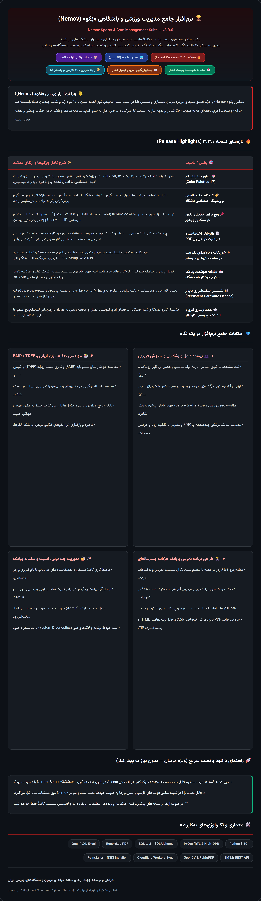

<div align="center">

<a href="https://github.com/AbolfazlSamadi2006/Nemov-App/releases/download/v3.3.0/Nemov_Setup_v3.3.0.exe">
  
</a>

<br/><br/>



<br/><br/>

<a href="https://github.com/AbolfazlSamadi2006/Nemov-App/releases/download/v3.3.0/Nemov_Setup_v3.3.0.exe">
  
</a>

</div>

---

<div dir="rtl" align="right">

<details>
<summary><b>👨‍💻 دستورات ترمینال ویژه توسعه‌دهندگان (Clone, Run & Build Installer)</b></summary>
<br/>

<div dir="ltr" align="left">

```powershell
# 1. Clone repository
git clone https://github.com/AbolfazlSamadi2006/Nemov-App.git
cd Nemov-App

# 2. Create virtual environment & install dependencies
python -m venv venv
.\venv\Scripts\activate
pip install -r requirements.txt

# 3. Run application from source
python main.py

# 4. Build standalone executable & Windows installer (Nemov_Setup_v3.3.0.exe)
.\venv\Scripts\pyinstaller.exe --noconfirm --clean Nemov.spec
"C:\Program Files (x86)\NSIS\makensis.exe" installer.nsi
```

</div>
</details>

</div>
