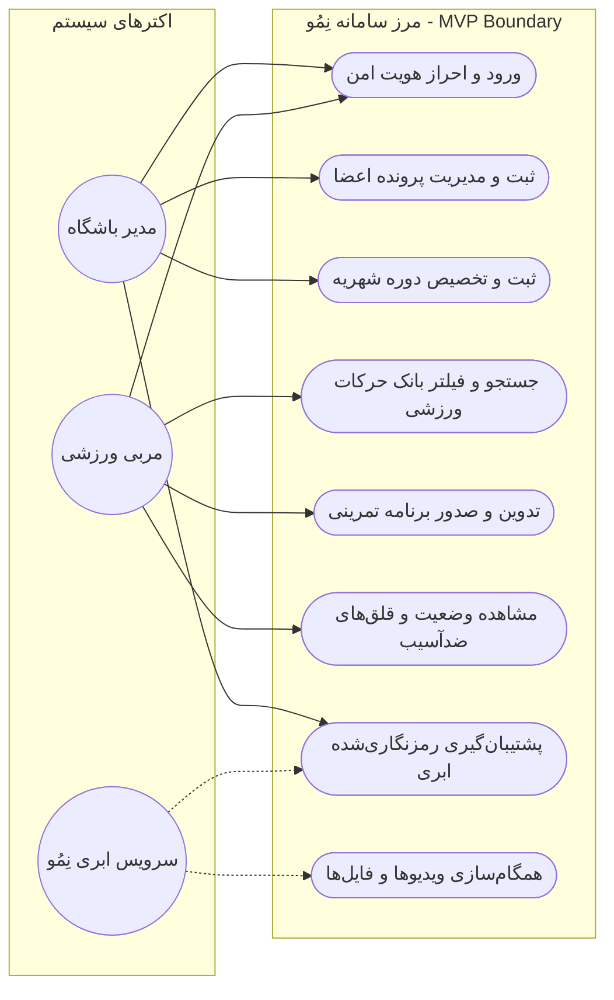
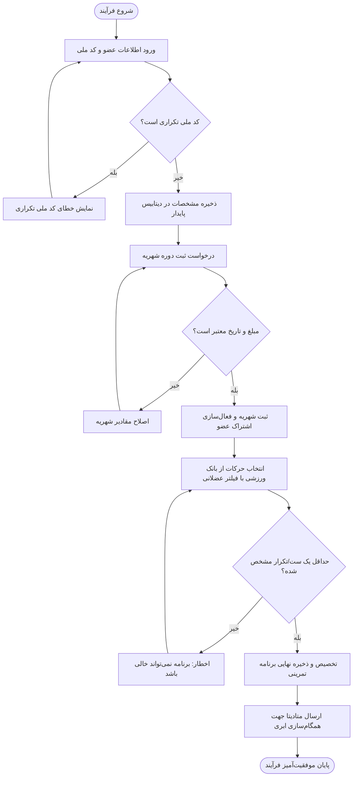
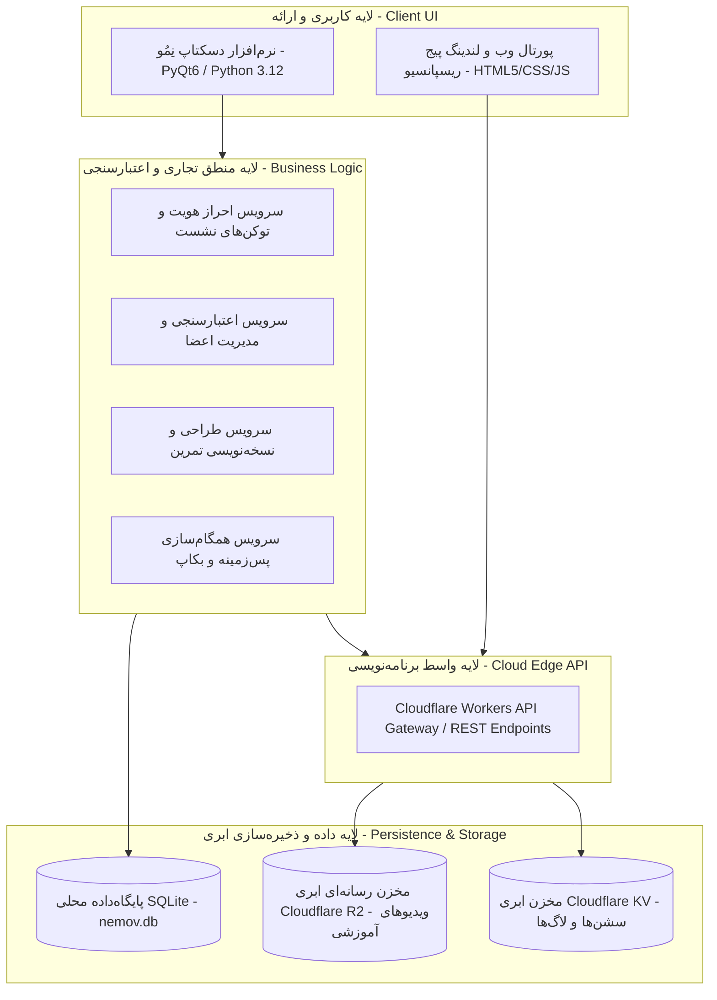
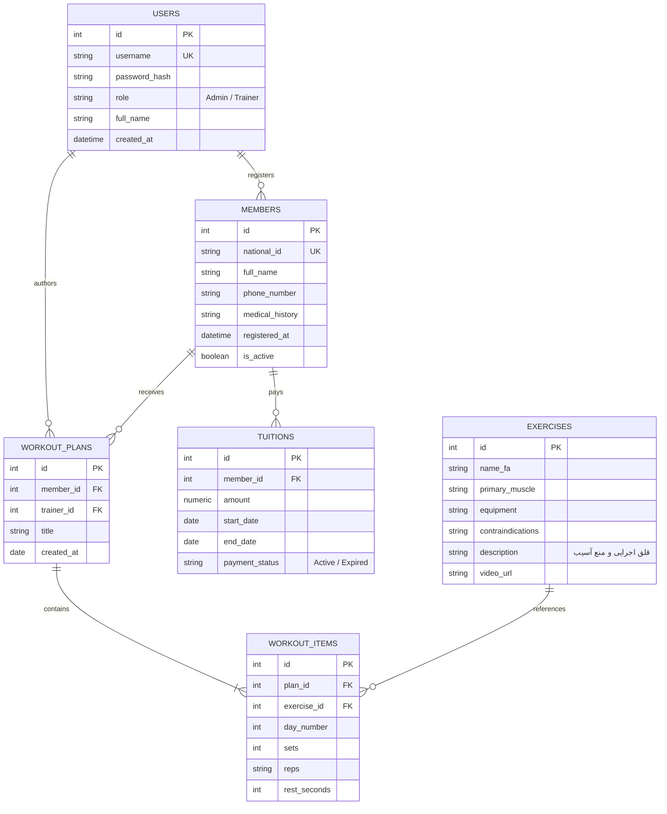

# فاز ۲: دیاگرام‌های تحلیل و طراحی مهندسی سیستم (UML & System Architecture)
## ددلاین رسمی: ۱۶ تا ۲۰ آبان ۱۴۰۵ | درس تحلیل و طراحی نرم‌افزار (SSAD)

در این بخش، چهار دیدگاه طراحی مهندسی الزامی طبق راهنمای درس مهندسی نرم‌افزار به همراه کدهای استاندارد رسم دیاگرام (Mermaid) قرار داده شده‌اند.

---

## ۱. دیاگرام موارد کاربرد (UML Use Case Diagram)
این دیاگرام اکترهای اصلی سامانه نِمُو (مدیر باشگاه، مربی و سیستم ابری) و تعامل آن‌ها با قابلیت‌های هسته MVP را نشان می‌دهد.

---

## ۲. دیاگرام فعالیت فرآیند اصلی (UML Activity Diagram)
فرآیند کلیدی انتخاب‌شده: **ثبت‌نام عضو جدید، تخصیص شهریه و صدور برنامه تمرینی اولیه** (همراه با مسیرهای شکست اعتبارسنجی و موفقیت).

---

## ۳. دیاگرام معماری سیستم (System Architecture Diagram)
نمایش لایه‌های چهارگانه نرم‌افزار، نحوه تبادل داده و پلتفرم‌های میزبانی:

---

## ۴. دیاگرام مدل داده و روابط موجودیت‌ها (ERD - Entity-Relationship Diagram)

