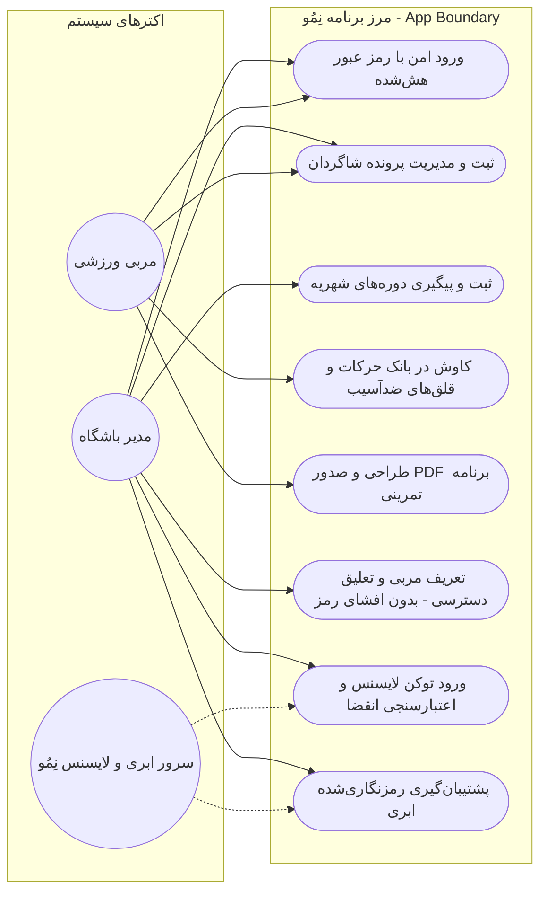
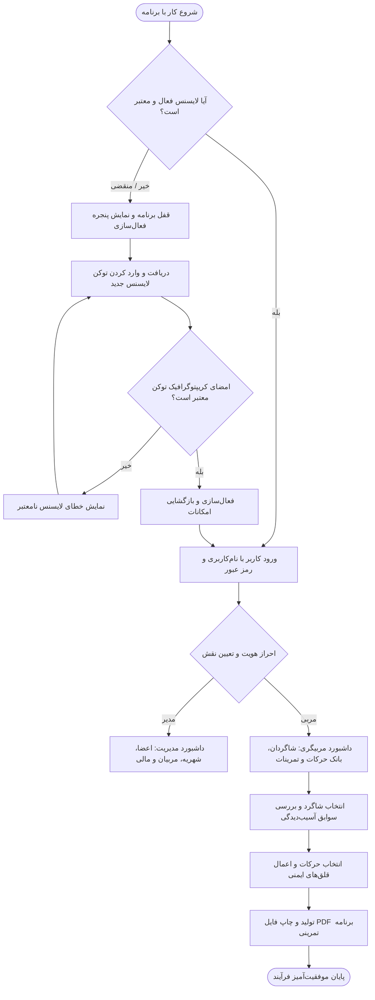
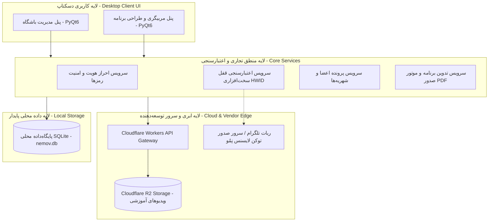
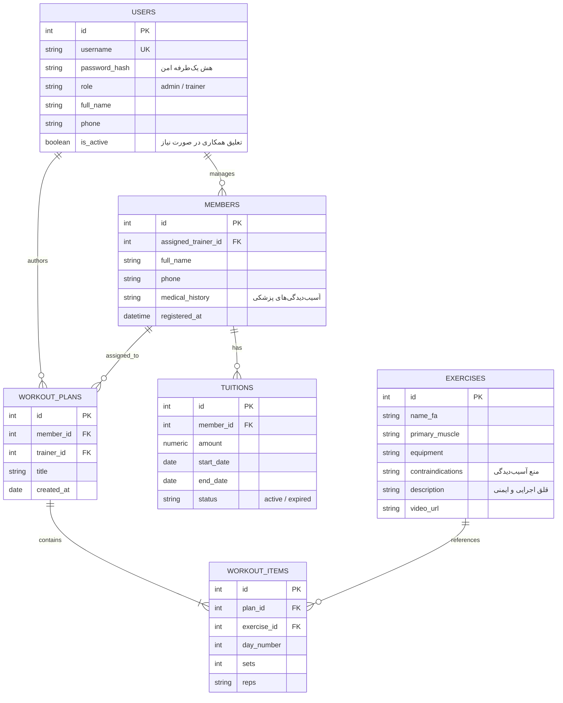

# فاز ۲: دیاگرام‌های تحلیل و طراحی مهندسی سیستم (UML & System Architecture)
## ددلاین رسمی: ۱۶ تا ۲۰ آبان ۱۴۰۵ | درس تحلیل و طراحی نرم‌افزار (SSAD)

در این بخش، چهار دیدگاه طراحی مهندسی الزامی طبق راهنمای درس مهندسی نرم‌افزار به همراه کدهای استاندارد رسم دیاگرام (Mermaid) قرار داده شده‌اند.

---

## ۱. دیاگرام موارد کاربرد (UML Use Case Diagram)
این دیاگرام اکترهای اصلی برنامه نِمُو (مدیر باشگاه، مربی و سرور ابری/لایسنس) و تعامل آن‌ها با قابلیت‌های هسته MVP را نشان می‌دهد.

---

## ۲. دیاگرام فعالیت فرآیند اصلی (UML Activity Diagram)
فرآیند کلیدی انتخاب‌شده: **اعتبارسنجی لایسنس، احراز هویت، انتخاب شاگرد و تدوین و صدور PDF برنامه تمرینی** (همراه با مسیرهای شکست اعتبارسنجی و موفقیت).

---

## ۳. دیاگرام معماری سیستم (System Architecture Diagram)
نمایش لایه‌های چهارگانه نرم‌افزار، نحوه تبادل داده، پلتفرم‌های میزبانی و سرویس لایسنس:

---

## ۴. دیاگرام مدل داده و روابط موجودیت‌ها (ERD - Entity-Relationship Diagram)

مدل داده‌های نرم‌افزار نِمُو با رعایت دقیق اصول مهندسی نرم‌افزار، نرمال‌سازی تا فرم سوم نرمال (3NF) و تفکیک دامنه‌های تجاری، در **دو سطح تجرید مهندسی (Abstraction Levels)** طراحی و مستند شده است:
1. **سطح ۱: مدل هسته ارائه (Core MVP ERD)** — تمرکز بر هسته عملیاتی تمرینات و حل رابطه چندبه‌چند ($M:N$) جهت ارائه‌های مدیریتی و دفاع مرحله اول (اسلاید ۹ ارائه فاز ۱).
2. **سطح ۲: مدل جامع داده‌های سیستم (Full Enterprise ERD)** — نقشه کامل، نرمال‌شده و پیاده‌سازی‌شده شامل تمامی ۲۰ جدول دیتابیس در ۵ زیرسیستم اصلی (ورزشکاران، تمرین، تغذیه، سلامت و پزشکی، امور مالی و اعلان‌ها) برای حل تمرین و ارزیابی فنی عمیق مهندسی نرم‌افزار.

---

### ۴.۱. سطح ۱: مدل هسته ارائه (Core MVP ERD — ۶ موجودیت کلیدی)
این دیدگاه برای درک سریع منطق هسته برنامه در ارائه‌های فنی و دفاعیه فاز اول تدوین شده است:
* **حل رابطه چندبه‌چند ($M:N$):** رابطه بین برنامه‌های تمرینی (`WORKOUT_PLANS`) و بانک حرکات (`EXERCISES`) از طریق جدول واسط `WORKOUT_ITEMS` حل شده و مقادیر ست، تکرار و شماره روز در جدول واسط ثبت می‌گردند.
* **تعلیق امن مربیان:** استفاده از فیلد `is_active` برای جلوگیری از حذف فیزیکی رکوردهای مربیان (Soft-Delete) و حفظ تاریخچه شاگردان قبلی.

---

### ۴.۲. سطح ۲: مدل جامع معماری داده‌ها (Full Enterprise System ERD — ۲۰ موجودیت واقعی)
این دیاگرام، ساختار کامل و پیاده‌سازی‌شده پایگاه‌داده نرم‌افزار نِمُو (`database_models.py`) را در قالب ۵ زیرسیستم اصلی نمایش می‌دهد:

1. **زیرسیستم کاربران، مربیان و ورزشکاران (Core Identity & Membership):**
   * `USERS`: حساب‌های کاربری مربیان و مدیران با تفکیک نقش (RBAC)، شماره تماس و فیلد غیرفعال‌سازی موقت.
   * `MEMBERS`: پرونده جامع شاگردان باشگاه با قد، وزن اولیه، سطح فعالیت، نوع عضویت، تاریخ ثبت‌نام و تاریخ انقضای شمسی و شناسه مربی مسئول.
2. **زیرسیستم سلامت، پرونده پزشکی و ارزیابی فیزیکی (Health & Anthropometry):**
   * `HEALTH_RECORDS`: رابطه یک‌به‌یک ($1:1$) با شاگرد؛ ذخیره سوابق آسیب‌های زانو، کمر، شانه، مچ، فشار خون، دیابت و منع‌های ورزشی.
   * `PHYSICAL_ASSESSMENTS`: سوابق دورسنجی دوره‌ای و ترکیب بدنی (وزن، درصد چربی، BMR، TDEE، دور بازو، سینه، شکم، باسن و عکس‌های قبل/بعد).
   * `MEDICAL_DOCUMENTS`: اسناد و مدارک پزشکی ضمیمه‌شده به پرونده شاگرد (ام‌آر‌آی، تصاویر آزمایش و نسخه‌ها).
3. **زیرسیستم مهندسی تمرینات و ساختار جلسات (Workout Engine):**
   * `EXERCISES`: بانک استاندارد حرکات ورزشی با عضله اصلی و فرعی، تجهیزات، آسیب‌های ممنوعه، قلق اجرایی و لینک ویدیوهای کلاد.
   * `WORKOUT_PLANS`: الگوها و برنامه‌های تمرینی مادر بر اساس هدف (هایپرتروفی، چربی‌سوزی، قدرت و تفکیک سطح).
   * `WORKOUT_DAYS`: جلسات تفکیک‌شده برنامه (روز ۱، ۲، ۳... و نام عضلات هدف در هر جلسه).
   * `WORKOUT_EXERCISES`: حرکات هر جلسه همراه با تعداد ست، تکرار، وزنه پیشنهادی، استراحت، تمپو و قلق مربی.
   * `WORKOUT_ASSIGNMENTS`: جدول تخصیص برنامه به شاگرد با تاریخ شروع، تاریخ ثبت و مربی تخصیص‌دهنده.
4. **زیرسیستم برنامه‌ریزی تغذیه و رژیم غذایی (Nutrition Engine):**
   * `FOOD_ITEMS`: بانک جامع مواد غذایی با اطلاعات درشت‌مغذی‌ها (کالری، پروتئین، کربوهیدرات، چربی بر حسب ۱۰۰ گرم).
   * `NUTRITION_PLANS`: برنامه‌های رژیم غذایی مادر با اهداف کالری کل و مقادیر گرم هدف برای ماکروها.
   * `MEAL_PLANS`: وعده‌های غذایی در طول شبانه‌روز (صبحانه، میان‌وعده صبح، ناهار، عصرانه، شام، میان‌وعده شب).
   * `MEAL_ITEMS`: اقلام غذایی هر وعده همراه با مقدار عددی و واحد مصرفی استاندارد.
   * `NUTRITION_ASSIGNMENTS`: جدول تخصیص رژیم غذایی به شاگرد همراه با دوره اعتبار.
5. **زیرسیستم مالی، اعلان‌ها و زیرساخت (Finance, SMS & System):**
   * `TUITION_PAYMENTS`: تراکنش‌های واریز شهریه اعضا همراه با تاریخ شمسی، نوع پرداخت و شناسه مربی ثبت‌کننده.
   * `CLUB_EXPENSES`: ثبت هزینه‌های جاری باشگاه (اجاره، قبوض، استهلاک تجهیزات، حقوق).
   * `NOTIFICATION_HISTORY`: سوابق پیامک‌های ارسالی با وب‌سرویس SMS.ir (سررسید شهریه، تبریک تولد، تغییر ساعت، رمز عبور یک‌بارمصرف).
   * `BACKUP_RECORDS`: لاگ‌های پشتیبان‌گیری محلی و ابری با حجم و تاریخ شمسی.
   * `SYSTEM_SETTINGS`: تنظیمات پویا، قفل لایسنس سخت‌افزاری HWID، کلیدهای ابری و هویت توسعه‌دهنده.

```mermaid
erDiagram
    %% -------------------------------------------------------------
    %% ماژول ۱: کاربران و اعضای باشگاه
    %% -------------------------------------------------------------
    USERS ||--o{ MEMBERS : "manages / registers"
    USERS ||--o{ WORKOUT_ASSIGNMENTS : "assigns"
    USERS ||--o{ NUTRITION_ASSIGNMENTS : "assigns"
    USERS ||--o{ TUITION_PAYMENTS : "receives"
    USERS ||--o{ CLUB_EXPENSES : "records"
    USERS ||--o{ WORKOUT_PLANS : "authors"
    USERS ||--o{ NUTRITION_PLANS : "authors"

    MEMBERS ||--|| HEALTH_RECORDS : "has (1:1)"
    MEMBERS ||--o{ PHYSICAL_ASSESSMENTS : "tracks"
    MEMBERS ||--o{ MEDICAL_DOCUMENTS : "submits"
    MEMBERS ||--o{ TUITION_PAYMENTS : "pays"
    MEMBERS ||--o{ WORKOUT_ASSIGNMENTS : "receives"
    MEMBERS ||--o{ NUTRITION_ASSIGNMENTS : "receives"
    MEMBERS ||--o{ NOTIFICATION_HISTORY : "receives"

    %% -------------------------------------------------------------
    %% ماژول ۲: مهندسی تمرینات و حرکات (Workout Subsystem)
    %% -------------------------------------------------------------
    WORKOUT_PLANS ||--|{ WORKOUT_DAYS : "divided_into"
    WORKOUT_PLANS ||--o{ WORKOUT_ASSIGNMENTS : "assigned_via"
    WORKOUT_DAYS ||--|{ WORKOUT_EXERCISES : "contains"
    EXERCISES ||--o{ WORKOUT_EXERCISES : "referenced_by"

    %% -------------------------------------------------------------
    %% ماژول ۳: برنامه‌ریزی تغذیه و رژیم (Nutrition Subsystem)
    %% -------------------------------------------------------------
    NUTRITION_PLANS ||--|{ MEAL_PLANS : "structured_into"
    NUTRITION_PLANS ||--o{ NUTRITION_ASSIGNMENTS : "assigned_via"
    MEAL_PLANS ||--|{ MEAL_ITEMS : "contains"
    FOOD_ITEMS ||--o{ MEAL_ITEMS : "referenced_by"

    USERS {
        int id PK
        string username UK
        string role "admin / trainer"
        string full_name
        string phone
        string email
        boolean is_active "تعلیق همکاری (Soft-Delete)"
    }

    MEMBERS {
        int id PK
        int user_id FK "مربی مسئول"
        string first_name
        string last_name
        string phone "ایندکس جستجو"
        string gender "male / female"
        string membership_type "جلسه‌ای / دوره‌ای"
        string membership_start_shamsi
        string membership_expire_shamsi
        string status "active / expired"
    }

    HEALTH_RECORDS {
        int id PK
        int member_id FK "رابطه یک‌به‌یک (UK)"
        boolean has_hypertension
        boolean has_diabetes
        string knee_injury "سوابق آسیب زانو"
        string back_injury "سوابق آسیب کمر"
        string shoulder_injury "سوابق آسیب شانه"
        string exercise_limitations "منع‌های ورزشی"
    }

    PHYSICAL_ASSESSMENTS {
        int id PK
        int member_id FK
        string assessment_date_shamsi
        float weight_kg
        float body_fat_percentage
        float bmr
        float arm_circ
        float chest_circ
        float waist_circ
    }

    MEDICAL_DOCUMENTS {
        int id PK
        int member_id FK
        string title
        string file_path "مسیر اسناد/آزمایش/MRI"
        string created_at_shamsi
    }

    TUITION_PAYMENTS {
        int id PK
        int member_id FK
        int user_id FK "مربی دریافت‌کننده"
        float amount "مبلغ دریافتی"
        string payment_date_shamsi
        string payment_type
    }

    CLUB_EXPENSES {
        int id PK
        int user_id FK "ثبت‌کننده هزینه"
        string title "عنوان هزینه"
        string category "اجاره/تجهیزات/قبوض"
        float amount
        string expense_date_shamsi
    }

    EXERCISES {
        int id PK
        string name_fa "نام فارسی حرکت"
        string primary_muscle "عضله اصلی"
        string equipment "تجهیزات/دستگاه"
        boolean is_corrective "حرکت اصلاحی"
        string contraindications "منع پزشکی"
        string video_url "لینک ویدیوی آموزشی"
    }

    WORKOUT_PLANS {
        int id PK
        int created_by_user_id FK "مربی طراح"
        string title "عنوان برنامه"
        string goal "هایپرتروفی/چربی‌سوزی"
        int days_per_week
        string training_level
    }

    WORKOUT_DAYS {
        int id PK
        int plan_id FK
        int day_number "شماره جلسه (روز ۱، ۲...)"
        string day_title "عضلات هدف جلسه"
    }

    WORKOUT_EXERCISES {
        int id PK
        int day_id FK
        int exercise_id FK
        int sets "تعداد ست"
        string reps "دامنه تکرار"
        int rest_seconds "زمان استراحت (ثانیه)"
        string tempo "ریتم حرکت"
    }

    WORKOUT_ASSIGNMENTS {
        int id PK
        int member_id FK
        int plan_id FK
        int assigned_by_user_id FK
        string start_date_shamsi
        boolean is_active
    }

    FOOD_ITEMS {
        int id PK
        string name_fa "نام ماده غذایی"
        string category "دسته غذایی"
        float calories "کالری در ۱۰۰ گرم"
        float protein_g "پروتئین"
        float carbs_g "کربوهیدرات"
        float fat_g "چربی"
    }

    NUTRITION_PLANS {
        int id PK
        int created_by_user_id FK "مربی طراح"
        string title "عنوان رژیم غذایی"
        string goal
        float target_calories "کالری هدف"
        float target_protein "پروتئین هدف (گرم)"
        float target_carbs "کربوهیدرات هدف (گرم)"
        float target_fat "چربی هدف (گرم)"
    }

    MEAL_PLANS {
        int id PK
        int plan_id FK
        string meal_name "صبحانه/ناهار/شام"
        int order_index
    }

    MEAL_ITEMS {
        int id PK
        int meal_id FK
        int food_id FK
        float amount "مقدار مصرفی"
        string unit "واحد"
    }

    NUTRITION_ASSIGNMENTS {
        int id PK
        int member_id FK
        int plan_id FK
        int assigned_by_user_id FK
        string start_date_shamsi
        boolean is_active
    }

    NOTIFICATION_HISTORY {
        int id PK
        int user_id FK
        int member_id FK
        string notif_type "تولد / شهریه / سانس"
        string title
        string date_shamsi
        boolean is_read
    }
```

---

### ۴.۳. اصول مهندسی و نکات برجسته در مدل داده پایگاه‌داده نِمُو
* **نرمال‌سازی تا فرم سوم نرمال (3NF):** کلیه وابستگی‌های غیرکلیدی به کلیدهای اصلی تفکیک شده و روابط چندبه‌چند میان تمرینات و برنامه‌ها و همچنین مواد غذایی و وعده‌ها از طریق جداول رابط نرمال‌سازی شده‌اند.
* **یکپارچگی ارجاعی و رفتار آبشاری (Cascade Delete):** با حذف یک برنامه تمرینی یا برنامه غذایی، رکوردهای روزها و وعده‌های وابسته به آن به طور خودکار پاکسازی می‌شوند، اما اطلاعات پایه حرکات و مواد غذایی دست‌نخورده باقی می‌مانند.
* **حذف امن (Soft-Delete) و حفظ تاریخچه:** به جای حذف فیزیکی حساب مربیان، فیلد `is_active` مانع از دست رفتن سوابق شاگردان قبلی می‌گردد.
* **رابطه یک‌به‌یک (1:1) اختصاصی برای پرونده سلامت:** جدول `HEALTH_RECORDS` با قید یکتایی بر روی `member_id` طراحی شده تا از حجیم شدن جدول اصلی اعضا جلوگیری نماید.
* **بهینه‌سازی کارایی با ایندکس‌گذاری (Indexing):** فیلدهای پرتکرار در جستجو (`username`، `phone`، `primary_muscle`، `status` و `name_fa`) دارای ایندکس‌های مستقل در سطح پایگاه‌داده هستند تا جستجوها در کسری از میلی‌ثانیه پاسخ داده شوند.
* **سازگاری کامل با تقویم شمسی:** فیلدهای تاریخ به صورت شمسی استاندارد (`YYYY/MM/DD`) ذخیره شده تا محاسبات انقضای دوره‌ها، یادآوری پیامکی سررسید شهریه و تبریک تولد به صورت کاملاً بومی و دقیق انجام پذیرند.

