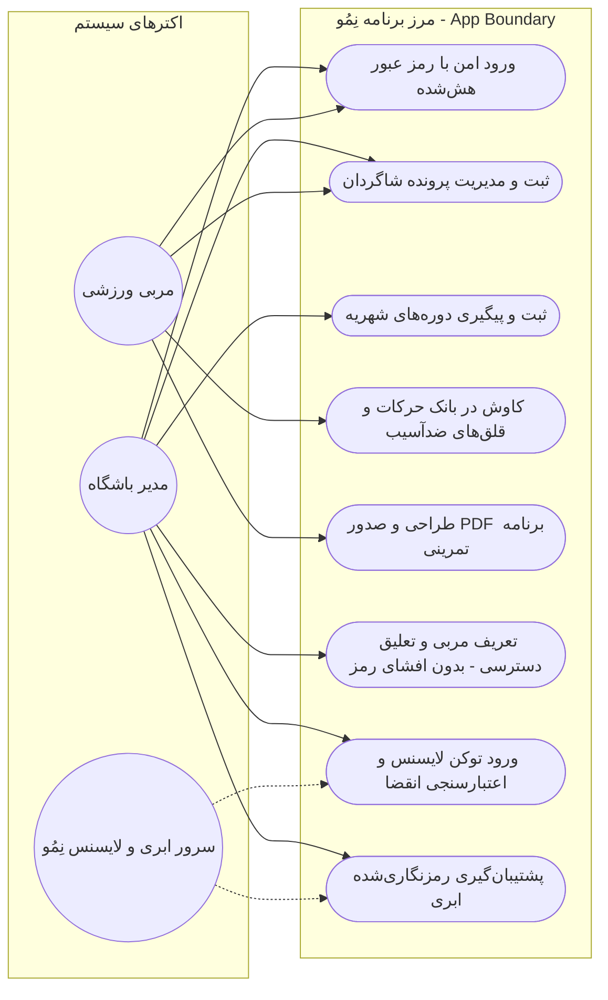
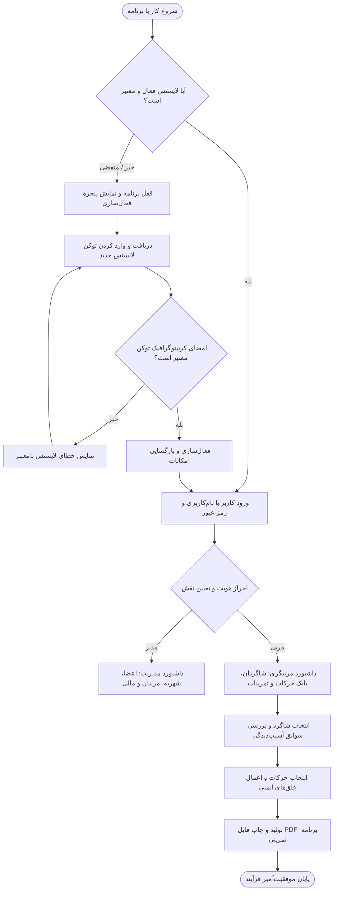
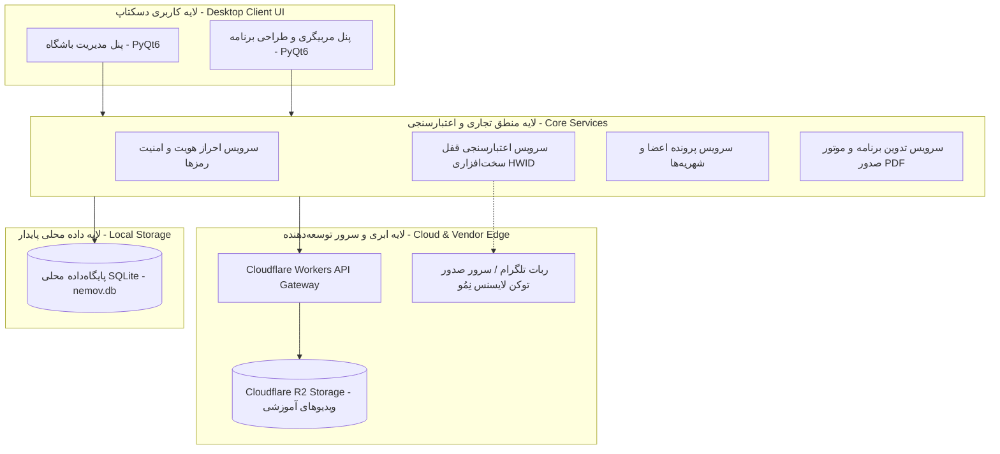
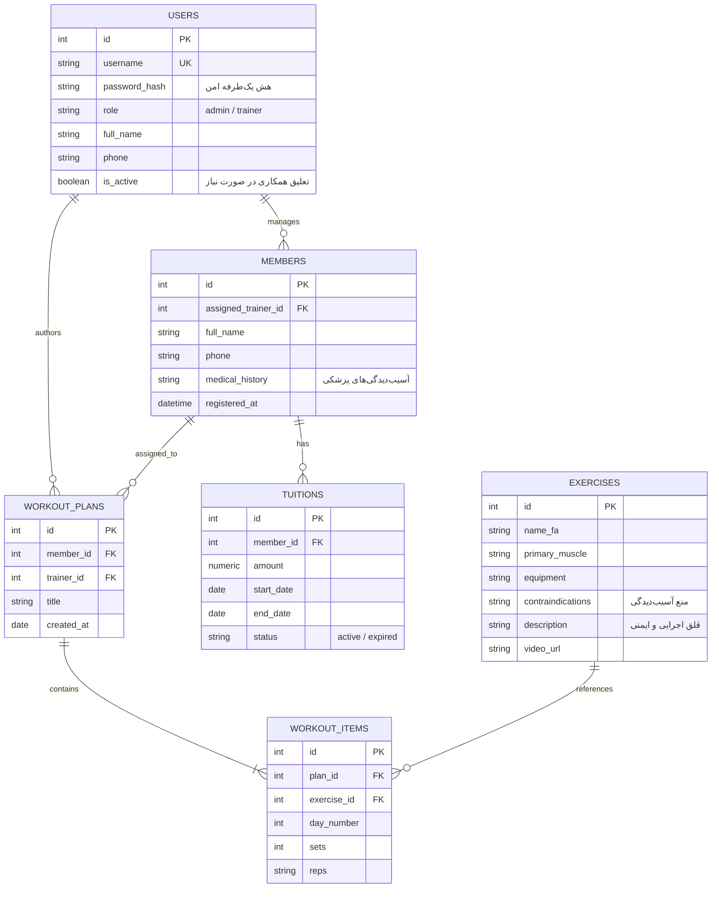

# فاز ۲: دیاگرام‌های تحلیل و طراحی مهندسی سیستم (UML & System Architecture)
## ددلاین رسمی: ۱۶ تا ۲۰ آبان ۱۴۰۵ | درس تحلیل و طراحی نرم‌افزار (SSAD)

در این بخش، چهار دیدگاه طراحی مهندسی الزامی طبق راهنمای درس مهندسی نرم‌افزار به همراه کدهای استاندارد رسم دیاگرام (Mermaid) قرار داده شده‌اند.

---

## ۱. دیاگرام موارد کاربرد (UML Use Case Diagram)
این دیاگرام اکترهای اصلی برنامه نِمُو (مدیر باشگاه، مربی و سرور ابری/لایسنس) و تعامل آن‌ها با قابلیت‌های هسته MVP را نشان می‌دهد.

---

## ۲. دیاگرام فعالیت فرآیند اصلی (UML Activity Diagram)
فرآیند کلیدی انتخاب‌شده: **اعتبارسنجی لایسنس، احراز هویت، انتخاب شاگرد و تدوین و صدور PDF برنامه تمرینی** (همراه با مسیرهای شکست اعتبارسنجی و موفقیت).

---

## ۳. دیاگرام معماری سیستم (System Architecture Diagram)
نمایش لایه‌های چهارگانه نرم‌افزار، نحوه تبادل داده، پلتفرم‌های میزبانی و سرویس لایسنس:

---

## ۴. دیاگرام مدل داده و روابط موجودیت‌ها (ERD - Entity-Relationship Diagram)
در این ساختار، فیلد `is_active` برای جدول مربیان لحاظ شده تا درصورت نیاز، تعلیق شود.

