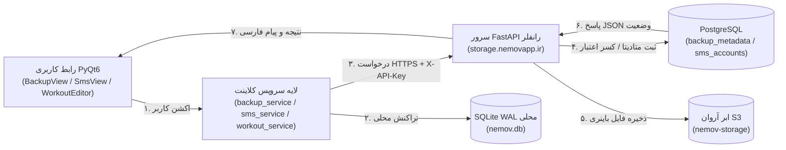

# فاز ۵: راه‌اندازی کد پایه، پایگاه‌داده، API و اولین یکپارچه‌سازی UI به API
## بازه زمانی رسمی: ۲۷ آبان تا ۷ آذر ۱۴۰۵ | درس تحلیل و طراحی سیستم‌های نرم‌افزاری (SSAD)

> **هدف فاز ۵ طبق برنامه زمان‌بندی درس:**  
> *Set up code, database, API, and the first UI-to-API integration.*

---

## ۱. راه‌اندازی مخزن و ساختار کد پایه (Code Setup & Repository Structure)

مخزن رسمی پروژه در گیت‌هاب به‌صورت دو بخش همگام (کلاینت دسکتاپ + سرور ابری) پیکربندی و متصل شده است:

```text
Nemov-App/
├── main.py                             # نقطه ورود برنامه دسکتاپ نِمُو
├── config.py                           # تنظیمات مسیر داده، دیتابیس محلی و آدرس سرور رانفلر
├── requirements.txt                    # پیش‌نیازهای کلاینت (PyQt6, SQLAlchemy, ...)
├── nemov/                              # پکیج اصلی نرم‌افزار دسکتاپ (UI / Services / Models)
│   ├── auth/authentication.py          # احراز هویت و نشست کاربر (CurrentUser)
│   ├── database/connection.py          # موتور SQLite (WAL) و SessionLocal
│   ├── models/database_models.py       # ۲۰ جدول مدل داده‌های SQLAlchemy ORM
│   ├── services/                       # لایه منطق تجاری و کلاینت‌های API ابری
│   │   ├── backup_service.py           # بکاپ اتمیک محلی + آپلود/بازیابی ابری از رانفلر
│   │   ├── cloud_sync_service.py       # همگام‌سازی ویدیو و تصاویر حرکات با ابر آروان
│   │   ├── sms_service.py              # کلاینت ارتباط با درگاه متمرکز پیامک در رانفلر
│   │   ├── autosave_service.py         # ذخیره خودکار ۳ دقیقه‌ای محلی و ۵ دقیقه‌ای ابری
│   │   └── draft_service.py            # ذخیره ۳ ثانیه‌ای پیش‌نویس‌های ناتمام
│   └── views/                          # رابط کاربری PyQt6
└── nemov_cloud_server/runflare_app/    # سرویس بک‌اند آنلاین روی رانفلر (FastAPI)
    ├── main.py                         # روت‌های REST API، لندینگ‌پیج و پنل مدیریت
    ├── db.py                           # مدیریت PostgreSQL (با فال‌بک SQLite محلی)
    ├── s3_storage.py                   # اتصال به فضای ابری آروان (ArvanCloud S3 API)
    └── requirements.txt                # پیش‌نیازهای بک‌اند (FastAPI, Uvicorn, Boto3, Psycopg)
```

---

## ۲. راه‌اندازی پایگاه‌داده (Database Setup)

### الف) پایگاه‌داده محلی کلاینت (SQLite WAL — Offline-First)
* موتور SQLAlchemy در `nemov/database/connection.py` به مسیر `nemov.db` متصل است و به‌صورت خودکار تنظیمات پایداری زیر را روی هر اتصال اعمال می‌کند:
  * `PRAGMA journal_mode=WAL` (نوشتن هم‌زمان و ایمن بدون قفل شدن UI)
  * `PRAGMA synchronous=NORMAL` و `PRAGMA busy_timeout=5000`
  * ایجاد جداول و مایگریشن خودکار (`init_db()` / `check_and_migrate_db()`) به‌همراه بذرپاشی داده‌های پایه (`seed_initial_data()`).
* **جداول اصلی تعریف‌شده در `nemov/models/database_models.py`:**
  `users`، `members`، `health_records`، `medical_documents`، `physical_assessments`، `exercises`، `workout_plans`، `workout_days`، `workout_exercises`، `workout_assignments`، `food_items`، `nutrition_plans`، `meal_plans`، `meal_items`، `nutrition_assignments`، `tuition_payments`، `club_expenses`، `backup_records`، `notification_history`، `system_settings`.

### ب) پایگاه‌داده ابری و فضای ذخیره‌سازی (Runflare PostgreSQL + ArvanCloud S3)
* بک‌اند در `nemov_cloud_server/runflare_app/db.py` (`DatabaseManager`) در محیط کلود به **PostgreSQL** (`DATABASE_URL`) و در اجرای محلی بدون تنظیم دیتابیس، خودکار به `local_fallback.db` متصل می‌شود و سه جدول ابری زیر را مدیریت می‌کند:
  1. `sms_accounts`: شارژ پیامکی مربیان، کلید موبایل و وضعیت حساب
  2. `sms_logs`: لاگ ارسال و تحویل پیامک‌های سیستم
  3. `backup_metadata`: فراداده آخرین نسخه پشتیبان مربیان (زمان شمسی، حجم فایل، نام مربی)
* فایل‌های باینری دیتابیس پشتیبان (به‌صورت خصوصی) و ویدیو/تصاویر حرکات ورزشی (به‌صورت عمومی) توسط `ArvanS3Storage` در باکت `nemov-storage` روی **ابر آروان** (`https://s3.ir-central1.arvanstorage.ir`) نگهداری می‌شوند.

---

## ۳. راه‌اندازی API و سرویس بک‌اند (Implemented REST API)

سرور FastAPI با عنوان **Nemov Cloud Server** روی دامنه `https://storage.nemovapp.ir` (پلتفرم رانفلر) مستقر و فعال است. درخواست‌های کلاینت با هدر امنیتی `X-API-Key` احراز هویت می‌شوند:

| متد | مسیر Endpoint | کاربرد | دیتابیس / استوریج درگیر | خطاهای مدیریت‌شده |
| :--- | :--- | :--- | :--- | :--- |
| `GET` | `/health` | بررسی سلامت سرور، اتصال PostgreSQL و S3 | `PostgreSQL`, `Arvan S3` | `503` در صورت خطا |
| `POST` | `/api/backup/upload` | دریافت فایل `.db` مربی و ذخیره ابری | `Arvan S3` + `backup_metadata` | `400`, `401`, `500` |
| `GET` | `/api/backup/download/{phone_raw}` | بازیابی آخرین دیتابیس مربی از ابر | `Arvan S3` | `401`, `404` |
| `POST/DELETE` | `/api/backup/delete/{phone_raw}` | حذف نسخه پشتیبان هنگام حذف حساب مربی | `Arvan S3` + `backup_metadata` | `401` |
| `POST` | `/api/video/upload`, `/api/image/upload` | آپلود رسانه تمرین به باکت آروان | `Arvan S3` | `401` |
| `GET/HEAD` | `/video/{filename}`, `/image/{filename}` | پخش مستقیم یا ریدایرکت به CDN آروان | `Arvan S3` | `404` |
| `GET` | `/api/sms/balance` | استعلام و ثبت خودکار اعتبار پیامکی مربی | `PostgreSQL (sms_accounts)` | `400` |
| `POST` | `/api/sms/send` | ارسال پیامک خدماتی و کسر آنی اعتبار | `PostgreSQL` + درگاه `SMS.ir` | `400`, `401`, `402`, `502` |
| `GET` | `/api/sms/history` | دریافت تاریخچه پیامک‌های ارسالی | `PostgreSQL (sms_logs)` | — |

---

## ۴. اولین یکپارچه‌سازی کامل UI تا API و دیتابیس (First UI-to-API Integration)

در این فاز اولین چرخه‌های کامل انتها-به‌-انتها (End-to-End) از رابط کاربری PyQt6 تا لایه سرویس، API بک‌اند و ذخیره‌سازی پایدار متصل و راستی‌آزمایی شدند:



1. **مسیر یکپارچه پشتیبان‌گیری ابری (UI → API → S3 + DB):**
   * کلیک روی دکمه پشتیبان‌گیری ابری در `BackupView` (یا تایمر ۵ دقیقه‌ای `AutoSaveManager`) ← فراخوانی `upload_cloud_backup()` ← ارسال `POST /api/backup/upload` با `X-API-Key` ← ذخیره فایل در `ArvanS3Storage` و ثبت متادیتا در `backup_metadata` (PostgreSQL) ← ثبت رکورد در `backup_records` محلی و نمایش نتیجه موفق در نوار پیشرفت UI.
2. **مسیر یکپارچه پیامک و احراز هویت OTP (UI → API → DB → SMS.ir):**
   * باز شدن تب `SmsView` یا درخواست کد OTP در `PasswordRecoveryDialog` ← فراخوانی `SmsService.get_balance()` / `send_single_sms()` ← فراخوانی `GET /api/sms/balance` و `POST /api/sms/send` ← کنترل موجودی در جدول `sms_accounts`، ارسال از طریق `SMS.ir`، ثبت در `sms_logs` و بازگشت مانده اعتبار به‌روزشده به UI.
3. **مسیر پایه UI → Service → SQLite WAL (ورزشکاران و برنامه‌های تمرینی):**
   * ثبت ورزشکار (`MemberFormDialog` → `MemberService.create_member`) و طراحی برنامه (`WorkoutEditorView` → `WorkoutService.create_workout_plan`) با ماندگاری کامل داده‌ها پس از بستن و باز کردن مجدد نرم‌افزار و پشتیبانی از پیش‌نویس خودکار.

---

## ۵. راهنمای اجرا و تست (Setup & Verification Commands)

### اجرای برنامه دسکتاپ از سورس:
```bash
pip install -r requirements.txt
python main.py
```

### اجرای بک‌اند FastAPI به‌صورت محلی (برای تست API و `/health`):
```bash
cd nemov_cloud_server/runflare_app
pip install -r requirements.txt
uvicorn main:app --host 0.0.0.0 --port 8000
# تست سلامت: http://localhost:8000/health
```

### اجرای تست‌های خودکار واحد و یکپارچگی (Unit & Integration Tests):
```bash
python -m unittest discover -s tests -p "test_*.py" -v
```
*(تمامی ماژول‌های دیتابیس WAL، بکاپ اتمیک و ابری، سرویس پیامک و OTP، احراز هویت، مدیریت تم‌ها، ویرایشگرهای تمرین/تغذیه و بازیابی پیش‌نویس‌ها دارای تست خودکار تحت پوشه `tests/` هستند.)*
